# Data model (§4 of the build brief)

Three scopes, as the brief requires:

- **Global reference data** (no `chamber_id`, no RLS): `FORUM`, `HOLIDAY`, `CAUSE_LIST_ENTRY`, `DISPLAY_BOARD_OBSERVATION`, `SOURCE_HEALTH`.
- **Chamber-owned data** (`chamber_id` on every row, Postgres row-level security, composite foreign keys that include `chamber_id`): everything else.
- **User-owned data** (`DAY_WATCH`, `NOTIFICATION_LOG`, notification preferences) hangs off a user *and* carries the user's `chamber_id`, so RLS covers it too.

**Built in Phase 0:** `CHAMBER`, `USER`, `AUDIT_LOG`. Everything else is the target for later phases and may change slightly when real source samples are inspected. Two entities are **proposed additions**, flagged in `docs/OPEN_QUESTIONS.md`:

- `CAUSE_LIST_MATCH`: the brief puts `matched_case_id` on `CauseListEntry`. Cause lists are public and shared, though, while a match belongs to one chamber, so this design splits them.
- `MATCH_ALIAS`: stores the aliases a chamber has confirmed, so the matcher "learns" them (§7).
- `CASE_NOTE` and `DEAD_LETTER`: §4 and §8 mention notes and a dead-letter table without defining their fields.

```mermaid
erDiagram
    CHAMBER ||--o{ USER : "members"
    CHAMBER ||--o{ CLIENT : "clients"
    CHAMBER ||--o{ CASE : "matters"
    CHAMBER ||--o{ IMPORT_BATCH : "imports"
    CHAMBER ||--o{ AUDIT_LOG : "audit trail"
    CHAMBER ||--o{ MATCH_ALIAS : "learned aliases"

    FORUM ||--o{ CASE : "hears"
    FORUM ||--o{ CAUSE_LIST_ENTRY : "publishes"
    FORUM ||--o{ DISPLAY_BOARD_OBSERVATION : "board shows"
    FORUM ||--o{ HOLIDAY : "closed on"
    FORUM ||--o{ ORDER : "issues"

    CASE ||--o{ CASE_CLIENT : ""
    CLIENT ||--o{ CASE_CLIENT : ""
    CLIENT |o--o{ USER : "read-only login"
    CASE ||--o{ CASE_ASSIGNMENT : ""
    USER ||--o{ CASE_ASSIGNMENT : "assigned (drives notifications)"
    CASE ||--o{ HEARING : "dates"
    CASE ||--o{ DEADLINE : "dates"
    CASE ||--o{ ORDER : "orders"
    ORDER |o--o{ DEADLINE : "source of"
    ORDER |o--o{ HEARING : "source of"
    CASE ||--o{ CASE_NOTE : "notes"
    USER ||--o{ CASE_NOTE : "writes"

    CAUSE_LIST_ENTRY ||--o{ CAUSE_LIST_MATCH : "matched as"
    CASE ||--o{ CAUSE_LIST_MATCH : "appears in"
    USER |o--o{ CAUSE_LIST_MATCH : "confirmed by"

    USER ||--o{ DAY_WATCH : "follows"
    CASE ||--o{ DAY_WATCH : "followed"
    CAUSE_LIST_ENTRY ||--o{ DAY_WATCH : "item on list"

    USER ||--o{ NOTIFICATION_LOG : "receives"
    NOTIFICATION_LOG ||--o| DEAD_LETTER : "failed send"
    USER ||--o{ IMPORT_BATCH : "uploads"
    USER |o--o{ AUDIT_LOG : "acts"

    CHAMBER {
        uuid id PK
        text name
        text city
        text timezone "default Asia/Kolkata"
        jsonb settings "digest 18:00, morning list 07:30, quiet hours"
        timestamptz deleted_at "soft delete"
    }
    USER {
        uuid id PK
        uuid chamber_id FK "UK (chamber_id, id) for composite FKs"
        text name
        enum role "owner|senior|associate|clerk|client_readonly"
        text email UK "lower-case, unique among active users"
        text phone
        bigint telegram_chat_id UK
        uuid client_id FK "client_readonly only (Phase 1)"
        jsonb notification_prefs
        timestamptz sessions_valid_after "sign out everywhere"
        timestamptz deleted_at
    }
    CLIENT {
        uuid id PK
        uuid chamber_id FK
        text name
        text phone
        text email
        text notes
    }
    FORUM {
        uuid id PK
        enum kind "supreme_court|high_court|district_court|tribunal|consumer_commission|other"
        text name
        text state
        text bench_or_establishment
        text source_adapter_key
    }
    CASE {
        uuid id PK
        uuid chamber_id FK
        uuid forum_id FK
        text cnr_number "UK per chamber when present"
        text case_type
        text case_number
        int year
        text filing_no
        text title
        text petitioner "trigram index"
        text respondent "trigram index"
        text petitioner_advocate
        text respondent_advocate
        text court_hall_judge_bench
        text stage
        enum status "pending|disposed|archived"
        date next_hearing_date "index (chamber_id, next_hearing_date)"
        date last_hearing_date
        enum source "ecourts_import|manual|lookup"
        jsonb raw_import
        timestamptz soft_deleted_at
    }
    CASE_CLIENT {
        uuid chamber_id FK
        uuid case_id FK
        uuid client_id FK
        text role_in_case
    }
    CASE_ASSIGNMENT {
        uuid chamber_id FK
        uuid case_id FK
        uuid user_id FK
        enum role "lead|junior|clerk"
    }
    HEARING {
        uuid id PK
        uuid chamber_id FK
        uuid case_id FK
        date date
        text purpose_stage
        enum source "import|cause_list|order|manual"
        enum date_origin "court|manual|system_suggestion"
        text outcome
        date next_date
        text notes
    }
    DEADLINE {
        uuid id PK
        uuid chamber_id FK
        uuid case_id FK
        date due_date
        text kind
        text title
        uuid source_order_id FK "nullable"
        bool is_court_sourced
        text notes
    }
    CASE_NOTE {
        uuid id PK
        uuid chamber_id FK
        uuid case_id FK
        uuid author_id FK
        text body
        bool is_private "visibility rule: open question"
    }
    CAUSE_LIST_ENTRY {
        uuid id PK
        uuid forum_id FK "index (forum_id, list_date)"
        date list_date
        enum list_type "regular|supplementary|advance|final"
        text hall_court_no
        text bench
        int serial_no
        text item_no
        text case_ref_raw
        text party_names_raw
        text source_url
        timestamptz fetched_at
        text parser_version
        text source_doc_sha256
    }
    CAUSE_LIST_MATCH {
        uuid id PK
        uuid chamber_id FK
        uuid cause_list_entry_id FK
        uuid case_id FK
        numeric match_confidence
        enum match_method "cnr|number|fuzzy_party|manual"
        enum status "auto|pending_confirmation|confirmed|rejected"
        uuid confirmed_by FK
    }
    MATCH_ALIAS {
        uuid id PK
        uuid chamber_id FK
        text kind "case_type|party|advocate"
        text alias
        text canonical
    }
    DISPLAY_BOARD_OBSERVATION {
        uuid id PK
        uuid forum_id FK
        text hall
        text current_item_no
        timestamptz fetched_at
        jsonb raw "append-only history"
    }
    DAY_WATCH {
        uuid id PK
        uuid chamber_id FK
        uuid user_id FK
        uuid case_id FK
        date hearing_date
        uuid cause_list_entry_id FK
        text hall
        text item_no
        enum alert_state "waiting|3_away|2_away|next|called|done|adjourned|lost_feed"
        bool muted
    }
    ORDER {
        uuid id PK
        uuid chamber_id FK
        uuid case_id FK "UK (case_id, sha256)"
        uuid forum_id FK
        date order_date
        text order_type
        text source_url
        text pdf_storage_key
        text sha256
        text extracted_text
        timestamptz fetched_at
        timestamptz notified_at
    }
    NOTIFICATION_LOG {
        uuid id PK
        uuid chamber_id FK
        uuid user_id FK
        enum channel "telegram|web_push|email"
        text kind
        text idempotency_key UK "(user, kind, entity, state)"
        text payload_hash
        timestamptz sent_at
        enum status "pending|sent|failed"
    }
    DEAD_LETTER {
        uuid id PK
        uuid notification_log_id FK
        text last_error
        int attempts
    }
    IMPORT_BATCH {
        uuid id PK
        uuid chamber_id FK
        uuid uploaded_by FK
        text file_name
        enum status "received|processing|done|failed"
        jsonb counts "created/updated/unchanged/failed"
        jsonb error_report
    }
    AUDIT_LOG {
        uuid id PK
        uuid chamber_id FK
        uuid actor_user_id FK "composite FK (chamber_id, actor_user_id)"
        text action "e.g. auth.login, case.next_date.changed"
        text entity_type
        uuid entity_id
        jsonb before
        jsonb after
        text request_id
        timestamptz created_at "append-only: app role has no UPDATE/DELETE"
    }
    HOLIDAY {
        uuid id PK
        uuid forum_id FK
        date date
        text description
        enum source "manual|official_calendar"
    }
    SOURCE_HEALTH {
        text adapter_key PK
        timestamptz last_success_at
        text last_error
        int consecutive_failures
        bool kill_switch
    }
```

